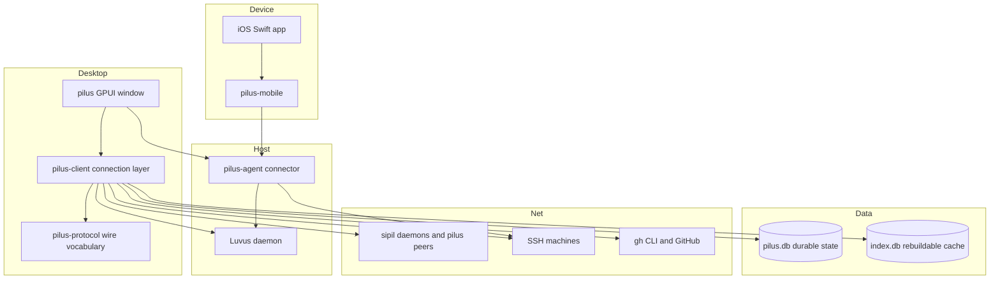

# Overview

`pilus` is a native desktop client for a [Luvus](https://github.com/RizRiyz/luvus) daemon. Luvus renders its entire terminal UI — workspaces, panes, agent docks, modals — as a grid of styled cells. `pilus` attaches to that daemon, folds the streamed frames into a `Surface`, and paints them in a GPUI window on macOS, while replacing the parts of the TUI it can claim with native chrome: the sidebar, the top bar, the tab strip, the status line, and a set of full-page views (Home, Search, Insights, Tasks, Mission Control, Files, Git, GitHub, Diff, Browser, Sipil chat).

Around that core it grew a second life: a host connector (`pilus-agent`) exposes a Luvus session to phones over iroh/QUIC, an iOS app plus `pilus-mobile` sit on the device side, and a separate iroh protocol (sipil) lets this window chat with people, channels, and durable agent daemons. Durable state lives in SQLite (`~/.pilus/pilus.db`); a rebuildable search index lives beside it (`index.db`); releases ship as signed DMGs through a Cloudflare-hosted OTA feed.

The repository is a Rust 2024 workspace of seven crates, plus a Swift iOS app, an Astro/Blume marketing site, and an Alchemy Cloudflare stack.

> Existing prose is not duplicated here: the [README](../README.md) gives the product tour and build commands, [docs/architecture.md](../docs/architecture.md) is the deep design narrative, and [AGENTS.md](../AGENTS.md) is the load-bearing invariant list. This wiki adds navigation and synthesis across all of them and the source.

## Architecture at a glance

The dependency chain is deliberately one-way: `pilus` → `pilus-client` → `pilus-protocol`. `pilus-agent` depends on `pilus-client` for its UHP surface but is never in the window's chain; `pilus-mobile` sits on the far side of the same door. `pilus-db` is a leaf shared by the stores, and `pilus-index` is a leaf cache. Nothing in the bottom two crates knows about GPUI, so the connection layer is testable headlessly.

## Navigation

### Architecture

- [System architecture](./architecture/system-architecture.md) — crates, dependency directions, entry points, threading model
- [Daemon surface and wire protocol](./architecture/daemon-surface.md) — discovery, handshake, frames, diffs, client-owned chrome
- [Native chrome and GPUI](./architecture/native-chrome.md) — window layout, pages, style/theme contract, idle budget
- [Remote access and the hub](./architecture/remote-access.md) — connector, enrollment, levels, hub fan-out, phones
- [Sipil network](./architecture/sipil-network.md) — iroh nodes, contacts, channels, mentions, offline behaviour
- [Persistence and data ownership](./architecture/persistence.md) — `pilus.db` vs `index.db`, settings, consent, private files

### Modules

- [pilus-protocol](./modules/protocol.md) — messages, frames, framing, theme and window types
- [pilus-client](./modules/client.md) — sockets, SSH transport, handshake, Surface, UHP, sipil client
- [pilus (GUI)](./modules/gui.md) — the GPUI window and every native page
- [pilus-agent](./modules/agent.md) — gateway lifecycle, iroh transport, enrollment, hub, service
- [pilus-mobile](./modules/mobile.md) — device-side iroh client and C FFI
- [pilus-db](./modules/db.md) — the durable SQLite file and migrations
- [pilus-index](./modules/index.md) — transcript indexing, search rows, token usage
- [iOS app](./modules/ios-app.md) — SwiftUI client over the C ABI
- [Site, infra, and release scripts](./modules/site-and-infra.md) — Blume site, Alchemy stack, DMG and OTA scripts

### Flows

- [Attach and paint](./flows/attach-and-paint.md) — socket discovery through a painted, diffed frame
- [Switch machines](./flows/machine-switch.md) — one window across Local and SSH endpoints
- [Pair a phone](./flows/phone-pairing.md) — QR code, enrollment, hub calls, UHP relay
- [Sipil message](./flows/sipil-message.md) — a channel line, a mention, and an agent's answer
- [Search, stats, and resume](./flows/session-search.md) — index a transcript, show usage, reopen a session
- [Release and update](./flows/release-update.md) — tag, package, publish, and self-update

### Concepts

- [Surface](./concepts/surface.md) — the client-side cell grid and its out-of-band requests
- [UHP](./concepts/uhp.md) — the daemon's structured control API, separate from the render protocol
- [Endpoint](./concepts/endpoint.md) — Local plus every saved SSH machine as one window
- [Sipil device ID](./concepts/sipil-device-id.md) — an iroh identity is the address and the authorization
- [Enrollment level](./concepts/enrollment-level.md) — view, control, operate, and who may raise them
- [Client-owned chrome](./concepts/client-owned-chrome.md) — which rows the daemon gives up and which it keeps
- [Idle cost](./concepts/idle-cost.md) — why an open window must let the CPU sleep
- [Migrations](./concepts/migrations.md) — append-only schema for durable state, rebuild for caches

### Guides

- [Change the wire protocol](./guides/protocol-message.md) — add a message without corrupting positional encoding
- [Add a UI control](./guides/ui-control.md) — extend `style.rs` and the playground first
- [Add a native page](./guides/native-page.md) — a page in the card, its state, and its place in the nav
- [Add a persisted setting](./guides/persisted-setting.md) — choose `settings.json` or `ui_state`, then wire it
- [Run visual captures](./guides/visual-captures.md) — render every surface with `visual-test`
