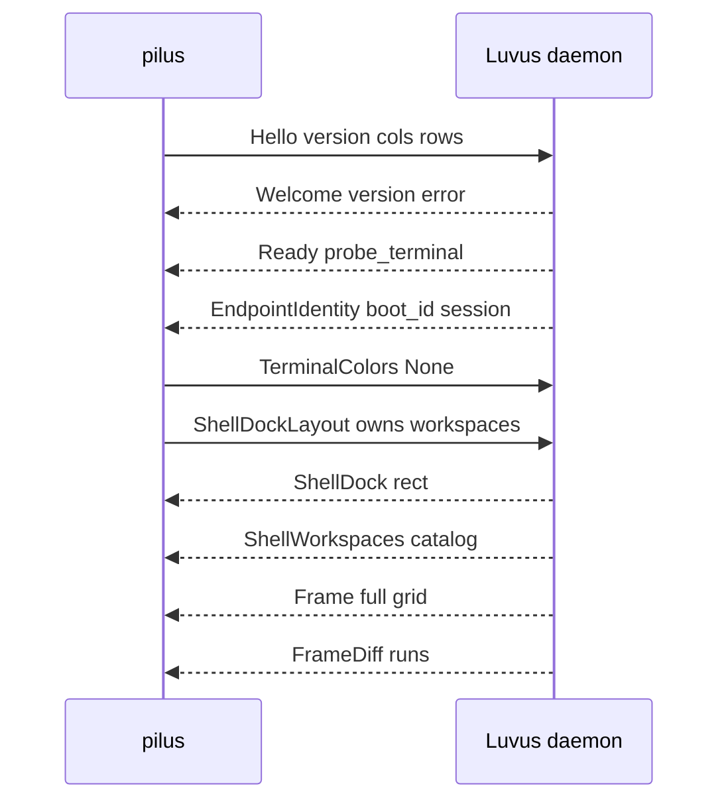

# Daemon surface and wire protocol

## Summary

A Luvus daemon renders its whole interface into a ratatui buffer and serializes that buffer as a grid of styled cells. `pilus` attaches to the *render* socket, agrees a protocol revision, then applies full frames and sparse diffs into a `Surface`. Structured state the render socket does not project is read over UHP on the daemon's *control* socket.

The protocol is positional bincode: enum variant order and struct field order **are** the wire format. `PROTOCOL_VERSION` is 20, with 18 as a negotiated fallback, in [lib.rs](../../crates/pilus-protocol/src/lib.rs).

## Diagram

## Key components

- **Discovery** — [discovery.rs](../../crates/pilus-client/src/discovery.rs) derives `$LUVUS_HOME` (else `~/.luvus`, `~/.luvus-dev` in debug) and the socket paths. A path too long for `sun_path` is relocated to a hashed owner-scoped alias under the temp directory.
- **Autostart** — [autostart.rs](../../crates/pilus-client/src/autostart.rs) runs `luvus server start` when nothing answers, pinned to the same state root; liveness is a dial, never a file check.
- **Transport** — [transport.rs](../../crates/pilus-client/src/transport.rs) hides a Unix socket, a TCP socket, or an `ssh -T` child behind one `Read + Write` `Stream`. `SshTarget` builds the command and records it in `netlog`; dropping the last handle kills the child so a parked reader unblocks.
- **Handshake and stream** — [connection.rs](../../crates/pilus-client/src/connection.rs) negotiates the version, spawns reader/writer/coalescer, and emits `ClientEvent`s. `Welcome` is decoded before the version check so a mismatch still has readable text.
- **Frames** — [frame.rs](../../crates/pilus-protocol/src/frame.rs) defines `CellData { symbol, fg, bg, mods }`, `FrameData`, `DiffRun`, and `FrameHyperlink`. `FrameData::validate` and `FrameData::apply_diff` are the only places that mutate a grid; a malformed diff is rejected whole and `Surface` flags `needs_full_frame`.
- **Surface** — [surface.rs](../../crates/pilus-client/src/surface.rs) folds messages and exposes out-of-band requests (notify, sounds, clipboard, open URL, workspace catalog, dock rect) as `take_*` calls.
- **UHP** — [uhp.rs](../../crates/pilus-client/src/uhp.rs) speaks the newline-delimited `{id, method, params}` JSON protocol; [control.rs](../../crates/pilus-client/src/control.rs) wraps it in `ControlClient` and the event-driven `AgentFeed`.
- **Messages** — [message.rs](../../crates/pilus-protocol/src/message.rs) holds `ClientMessage` (key, mouse, paste, resize, surface interest, dock claims, clipboard receipts) and `ServerMessage` (welcome, frames, notify, sound, clipboard, open URL, dock projection, switch/prepare/health).

## Client-owned chrome

The daemon does not project a sidebar, so the client claims it. After the handshake, `ShellDockLayout { owns_workspaces: true, owns_session_chrome: true }` tells the daemon to blank the workspaces dock and the session pill and start projecting `ShellWorkspace` rows plus a `ShellDockRect` cell rectangle. The client drops the agents dock from `ShellSidebars` and sends the layout back with a bumped revision, so the workspaces slot grows. The tab bar and status line cannot be claimed at all — they are overpainted, not reclaimed. Details and the ownership table live in [Client-owned chrome](../concepts/client-owned-chrome.md).

## Frames, colors, and input

`mods` is the ratatui `Modifier` bitset. A color is packed with a tag byte: `0` means the client default, `1` an ANSI palette index, `2` 24-bit sRGB. [theme.rs](../../crates/pilus/src/gui/theme.rs) resolves tags into paintable colors, using the active scheme's sixteen ANSI slots rather than the fixed xterm table.

Input is forwarded as crossterm events: [keys.rs](../../crates/pilus/src/gui/keys.rs) maps a GPUI keystroke back to `KeyEvent`, dropping modifier-only strokes and suppressing Alt when Option composed a different glyph. Clicks send `Down` then `Up`; drags are client-side selection; hover sends `Moved` only when the pointer crosses a cell.

## Design decisions

- **Diffs are all-or-nothing.** A torn grid is worse than a reload, so a bad diff is rejected and a full frame requested once per outage (`resync_requested`).
- **Two protocol revisions, one build.** `FALLBACK_PROTOCOL_VERSION` and a per-reader-thread `DECODE_VERSION` let one build attach to a 0.14.2 or 0.14.3 daemon; the frame deserializer is hand-written because the `hyperlinks` field moved the layout.
- **Render vs control.** Mixing structured JSON into the frame stream would couple every UI feature to a binary format change, so UHP carries it separately and is versioned by method behaviour, not by `PROTOCOL_VERSION`.
- **Openable URLs are filtered.** `surface::openable_url` admits only http, https, and mailto before anything reaches the system opener.

## Related

- [Surface](../concepts/surface.md), [UHP](../concepts/uhp.md), [Client-owned chrome](../concepts/client-owned-chrome.md)
- [pilus-protocol](../modules/protocol.md), [pilus-client](../modules/client.md)
- [Attach and paint](../flows/attach-and-paint.md)
- [Change the wire protocol](../guides/protocol-message.md)
