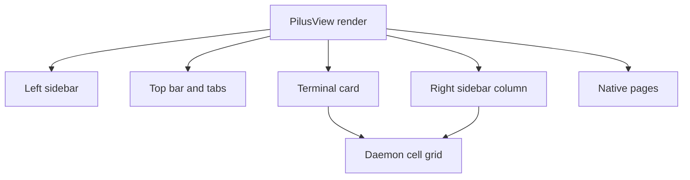

# Native chrome and GPUI

## Summary

The window is a GPUI application whose render function paints the daemon's cell grid inside a hand-built chrome. The native layer owns: the left sidebar, the unified top bar (sidebar toggle, target, tabs, plus, menu, connection status), the tab strip, the status bar, the right sidebar column, and a family of full-card pages. Everything else is the daemon's grid.

The visual contract is [style.rs](../../crates/pilus/src/gui/style.rs) plus the [UI Playground](../../crates/pilus/src/gui/ui_playground.rs): a working catalogue of every native element. A control that is not in the playground is added there first, implemented once in `style.rs`, then used.

## Diagram

## Key components

- **`PilusView`** — [gui/mod.rs](../../crates/pilus/src/gui/mod.rs) holds the window state: endpoints, surfaces, sidebar animation, tab slide/drag, prompt modals, toasts, and the render function. `InputLayer` decides who owns the keyboard (terminal, sidebar, right column, sipil panel, text field).
- **Style and theme** — [style.rs](../../crates/pilus/src/gui/style.rs) is the only implementation of the design system: buttons, fields, section labels, fill states, chevrons, spinners, heat cells, ranking rows, tree rows, transitions. [theme.rs](../../crates/pilus/src/gui/theme.rs) resolves wire colors and holds chrome roles; [scheme.rs](../../crates/pilus/src/gui/scheme.rs) holds built-in Luvus palettes. Literal colors belong only in those two files.
- **Fonts** — [fonts.rs](../../crates/pilus/src/gui/fonts.rs) registers bundled typefaces; every window root calls `apply_chrome_font`, and sizes resolve through `style::Fonts::resolve` or `style::scaled` so the Interface setting reaches all chrome.
- **Geometry** — 28 px regular controls, 24 px compact, `px_2`/`px_3` padding, `rounded_md` for controls/cards/overlays, `rounded_lg` for large floating panels.
- **Motion** — floating panels and pages open through `style::enter`; hover and selection use `FillExt::hover_fill` / `state_fill`; disclosure uses `style::chevron`; switches `style::toggle`; status `style::spinner`. Every new animation honors `cx.reduce_motion()`.
- **Sidebar** — workspaces (pinned, recent, grouped by endpoint), agents, sipil rows (daemons, channels, people), GitHub repositories. Selection is the `theme.panel` pill with bold name, not `selection_bg`.
- **Right sidebar** — [right_sidebar.rs](../../crates/pilus/src/gui/right_sidebar.rs) is a column beside the terminal card toggled with Cmd+B. Tabs include Changes, History, Files, Ports, Browser, Sipil, and markdown documents. Only the open tab polls.
- **Pages** — Home ([overview.rs](../../crates/pilus/src/gui/overview.rs)), Search ([search.rs](../../crates/pilus/src/gui/search.rs)), Insights ([stats.rs](../../crates/pilus/src/gui/stats.rs)), Tasks ([tasks.rs](../../crates/pilus/src/gui/tasks.rs)) and its canvas layout ([orchestration.rs](../../crates/pilus/src/gui/orchestration.rs)), Mission Control ([mission.rs](../../crates/pilus/src/gui/mission.rs)), Automations, Diff ([diff.rs](../../crates/pilus/src/gui/diff.rs)), GitHub ([github_page.rs](../../crates/pilus/src/gui/github_page.rs)), Process ([process.rs](../../crates/pilus/src/gui/process.rs)), Database ([database.rs](../../crates/pilus/src/gui/database.rs)), and session replay ([session_view.rs](../../crates/pilus/src/gui/session_view.rs)).
- **Backdrop** — [glass.rs](../../crates/pilus/src/gui/glass.rs) owns an `NSVisualEffectView` pinned to the dark appearance; the window stays `Transparent` and the blur slider drives `alphaValue`. GPUI's `Blurred` appearance is deliberately not used.
- **Menu bar and Dock** — [menubar.rs](../../crates/pilus/src/gui/menubar.rs) is a glanceable agent list that works with no window; [dock.rs](../../crates/pilus/src/gui/dock.rs) bounces and badges for pushes that land in the background; [notify.rs](../../crates/pilus/src/gui/notify.rs) posts system notifications and [sound.rs](../../crates/pilus/src/gui/sound.rs) synthesizes cues.

## Layout rules

The window root is a flush card, so a page runs to the window's edges. The terminal grid never takes an opacity fade (a translucent window would show the desktop through it); `reflow_alpha` fades its text instead. The daemon is not resized while the sidebar tweens: it reflows once when the dock settles, because in-between sizes make it reflow again.

## Idle budget

The tick loop in [gui/mod.rs](../../crates/pilus/src/gui/mod.rs) (`next_tick`) runs at the frame rate only while something moves (tween, toast, cursor fade, sidebar freeze); otherwise 50 ms in front and 250 ms behind another app. Daemon frames wake it through `Arrival`, so output never waits for a tick. The cursor does not blink unless `Settings::cursor_blink` is on, and then stops after ten seconds ([cursor_blink.rs](../../crates/pilus/src/gui/cursor_blink.rs)). Timer-driven polls pass through [activity.rs](../../crates/pilus/src/gui/activity.rs), which stretches intervals fivefold while pilus is behind another app. `PILUS_PERF=1` prints per-second counters ([perf.rs](../../crates/pilus/src/gui/perf.rs)); the Process page shows the same costs live.

Energy mode (`Settings::energy_mode`) overrides the person's appearance choices at the point of use: square corners except the pill and tab, solid surfaces so the blur view is dropped, reduced motion, and a slower tick. The Appearances sliders keep reading the originals.

## Design decisions

- **One implementation of each control.** The playground is executable documentation; hand-rolling a button in a page is a bug because it drifts from the design system.
- **Theme roles, never literals.** The color scheme owns every border and hairline through `theme.border`; accent means progress or focus, not a panel edge.
- **Scoped key contexts.** Editor chords are a `KeyBinding` in the `MdEditor` context rather than a check in a handler, so Cmd+S saves instead of toggling the sidebar.
- **Native only where the daemon cannot project.** The tab bar and status line are overpainted because the protocol cannot reclaim those rows; everything else is either projected or read over UHP.

## Related

- [Client-owned chrome](../concepts/client-owned-chrome.md)
- [Idle cost](../concepts/idle-cost.md)
- [pilus (GUI)](../modules/gui.md)
- [Add a UI control](../guides/ui-control.md)
- [Run visual captures](../guides/visual-captures.md)
