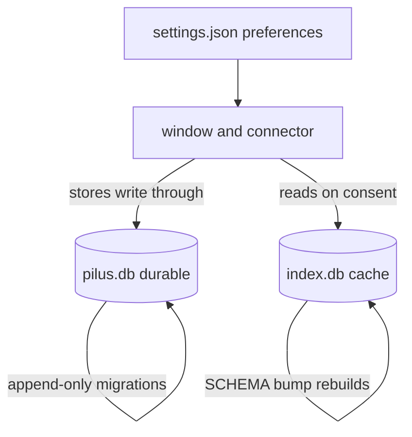

# Persistence and data ownership

## Summary

pilus keeps two SQLite files and one JSON preferences file, and the difference between them is load-bearing:

- `~/.pilus/pilus.db` is **durable**. It holds the only copy of sipil conversations, contacts, channels, offline snapshots, markdown notes, the GitHub cache, and the window's per-item state. It is migrated, never dropped, and a file from a newer pilus is refused (`Error::Newer`) rather than written to.
- `~/.pilus/index.db` is a **cache**. It holds titles and token usage from agent transcripts. A `SCHEMA` bump drops and rebuilds it, and `wipe` deletes it when consent is withdrawn.
- `~/.pilus/settings.json` holds preferences that `pilus-agent`'s `relay` block and `--check-updates` also read without opening the database.

The split is enforced by [pilus-db](../../crates/pilus-db/src/lib.rs) and [pilus-index](../../crates/pilus-index/src/lib.rs), and the rules are repeated in [AGENTS.md](../../AGENTS.md) because they are easy to break.

## Diagram

## Key components

### pilus.db

[Db::at](../../crates/pilus-db/src/lib.rs) hands every caller in the process the same connection for a folder, so a store and the settings never contend through two writers. A store keeps its working copy in memory and writes each change through. Lock order is always the store's lock first, then the database's; a `Db` method is never called inside `Db::transaction` (use the `tx`, as `put_doc_in` does).

The schema is an append-only list in [schema.rs](../../crates/pilus-db/src/schema.rs): a released migration is never edited. Tables include doc-style `docs`, the import ledger `imports`, and row-growing `chat_threads`, `chat_lines`, `chat_requests`, `chat_cursors`, `md_notes`, and `github_cache`. Small always-whole state (contacts, channels, offline, `ui_state`) is one `docs` row; anything that grows a row at a time is a table.

A store that used to be a flat file imports it once on first open (`Db::import_once`, tagged in `imports`) and sets it aside as `<name>.migrated` via `pilus_db::retire`; it never deletes it, so downgrading is a rename away.

### index.db

[pilus-index](../../crates/pilus-index/src/store.rs) uses `SCHEMA = 3` and two tables: `sessions` (title, machine, agent, path, timestamps, metadata) and `usage` (machine, transcript, hour, model, four token counts, turns, recorded cost). A mismatch drops the file and rebuilds from transcripts, which is cheaper than migrating a cache. Usage rows are written in the same transaction as the session row, so a session never exists without the usage its size says was read.

Nothing may read a transcript until `Settings::index_agents` is on; a remote machine is read only while its id is in `Settings::index_machines`. Turning the feature off calls `pilus_index::wipe`, and unticking a machine forgets its rows. Search and Insights share this consent.

### settings.json vs ui_state

[settings.rs](../../crates/pilus/src/settings.rs) splits `Settings` fields: font, theme, update channel, booleans, and relay preferences live in `settings.json`; per-item window state (`window`, `session_labels`, `session_icons`, `github_pinned`, `sipil_order`, `last_session`, `last_endpoint`, pane sizes, `ui_state` document) lives in `pilus.db`. The fields stay on one struct so a reader does not care where they live; `load` fills them and `save` writes each back to its home.

### Private files

Everything under `~/.pilus` is owner-only: `pilus_db::create_private` for a new file, `write_private` (staged, synced, renamed) for a replacement, `private_dir` keeps a folder `0700`. The connector keeps its identity, devices, socket, and log under `~/.pilus/agent` with the same discipline. Remote saves try to match it: the write is staged beside the file and copied over only when every byte arrived.

## Design decisions

- **Durable means migrated.** A schema change is a new entry at the end of `MIGRATIONS`; a released one is never edited. A newer file is refused rather than downgraded, because silently dropping columns loses conversations.
- **Caches may be thrown away.** `index.db` is reproducible from transcripts, so rebuilding beats migrating and consent withdrawal is a delete.
- **Stores write through.** Keeping a working copy in memory makes reads cheap and makes each change durable immediately; a crash leaves the old document rather than half a new one.
- **Logs are not state.** Warnings and panics go to `~/.pilus/logs/pilus.log` via `tracing`, never `eprintln!`, so a bundle launched from Finder still reports trouble.

## Related

- [Migrations](../concepts/migrations.md)
- [pilus-db](../modules/db.md), [pilus-index](../modules/index.md)
- [Search, stats, and resume](../flows/session-search.md)
- [Add a persisted setting](../guides/persisted-setting.md)
