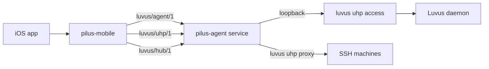

# Remote access and the hub

## Summary

A Luvus daemon opens no TCP listener and its access gateway binds loopback only. To reach a session from a phone, something on the host must launch the gateway, carry its bytes, and authorize devices. That is `pilus-agent`, a per-user background service that outlives the window. The phone talks iroh/QUIC to the connector, the connector talks loopback to a `luvus uhp access` gateway, and a hub method set fans requests out to the host's saved SSH machines.

## Diagram

## Key components

- **Gateway lifecycle** — [lib.rs](../../crates/pilus-agent/src/lib.rs) defines `Gateway::start` (launch `luvus uhp access`, read the one-line descriptor, keep the child) and `Descriptor::parse`, which reads `protocol`, `endpoint.host/port`, `pairing.code`, `authority`, and `features`. Additive fields are ignored so a newer daemon needs no new connector.
- **Supervisor** — [supervisor.rs](../../crates/pilus-agent/src/supervisor.rs) starts the gateway, pairs, publishes the delegated token to `AuthState`, and restarts with capped backoff when the child dies. It may run `luvus server start` at most once a minute.
- **Transports** — [proxy.rs](../../crates/pilus-agent/src/proxy.rs) is a TCP listener for a trusted network; [p2p.rs](../../crates/pilus-agent/src/p2p.rs) is the iroh endpoint on `luvus/uhp/1`, one QUIC stream per gateway connection. An `EndpointHooks` allow-list rejects peers after the handshake.
- **Enrollment** — [enroll.rs](../../crates/pilus-agent/src/enroll.rs) owns the control ALPN `luvus/agent/1`. A device proves itself once with a short code; afterwards its `EndpointId` is the authorization and is persisted in `devices.json`. Each new enrollment rotates the code.
- **Hub** — [hub.rs](../../crates/pilus-agent/src/hub.rs) is one front door on `luvus/hub/1`. `local` goes to the gateway; any other machine id goes through `luvus uhp proxy` over the user's SSH. Hub-only methods: `hub.machines`, `hub.agents`, `hub.folders`, `hub.run`, `hub.watch`, plus `hub.gh.*`.
- **Watch** — [watch.rs](../../crates/pilus-agent/src/watch.rs) turns the daemon event feed into topic signals (`changed` with topics, `output` with pane ids) and never relays event payloads, so a stream cannot leak prompts or cwd.
- **Service** — [service.rs](../../crates/pilus-agent/src/service.rs) installs a LaunchAgent or user systemd unit. `install` is idempotent and leaves a healthy running service alone; `status` reports `restart_needed` (binary newer than process) and Linux `linger`.
- **Admin socket** — [admin.rs](../../crates/pilus-agent/src/admin.rs) is the owner-only `agent.sock` the window reads: `status`, `new_code`, `set_level`, `revoke`, `retry`. It never returns an enrollment code in `status`, and it can only lower a level.
- **Device side** — [pilus-mobile](../../crates/pilus-mobile/src/lib.rs) mirrors the ALPN constants, persists the iroh identity and enrollment, exposes `hub.watch` handling, and [ffi.rs](../../crates/pilus-mobile/src/ffi.rs) is the C ABI the Swift app calls.

## Levels

What a paired device may call is stored per device and checked on every stream:

| Level | May call |
| --- | --- |
| `view` | Read-only subset of the gateway's methods |
| `control` | The gateway token's `allowed_methods` plus diff review writes and sends |
| `operate` | Control plus `task.add`, `task.start`, `agent.start`, `workspace.open` (remote code execution by design) |

A level can only be **raised** by a live enrollment code minted at that level; the admin socket can only lower it. An empty gateway allow-list fails closed at every level. Streaming or blocking methods are refused at every level except `hub.watch`. See [Enrollment level](../concepts/enrollment-level.md).

## State and lifecycle

The connector's state lives under `~/.pilus/agent`: `identity.key`, `devices.json`, `agent.sock`, and `agent.log`. Older builds wrote under the Luvus root; first run moves them and never overwrites a file at the new path. The window never spawns the service as a child; [gui/connector.rs](../../crates/pilus/src/gui/connector.rs) caches the admin answer from a poller thread and runs install/remove/code/revoke on short-lived threads.

## Design decisions

- **One door per machine.** A phone pairs with the Mac it trusts, not with every SSH host that Mac can reach; fan-out stays on the trusted side.
- **Authority is a token, not the pairing code.** The code is one-use and short-lived; the connector holds the gateway token for its whole run (`--no-expiry`), so no device re-enrolls on a gateway restart.
- **Signals, not events.** `hub.watch` exposes topics and pane ids only; the device refetches under its own level.
- **Audit without payloads.** Every device write and refusal is logged with device, level, machine, method, and outcome — never parameters, which may hold prompts.

## Related

- [Enrollment level](../concepts/enrollment-level.md)
- [pilus-agent](../modules/agent.md), [pilus-mobile](../modules/mobile.md), [iOS app](../modules/ios-app.md)
- [Pair a phone](../flows/phone-pairing.md)
- [Switch machines](../flows/machine-switch.md)
