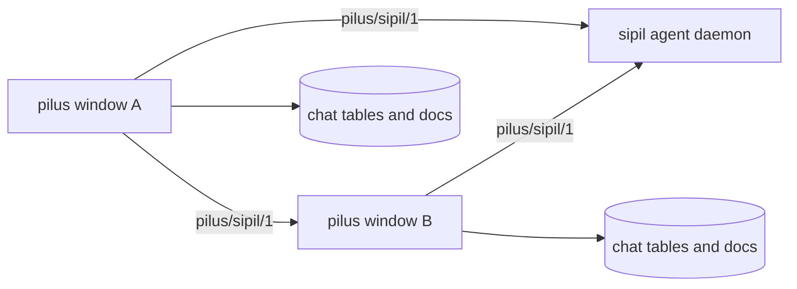
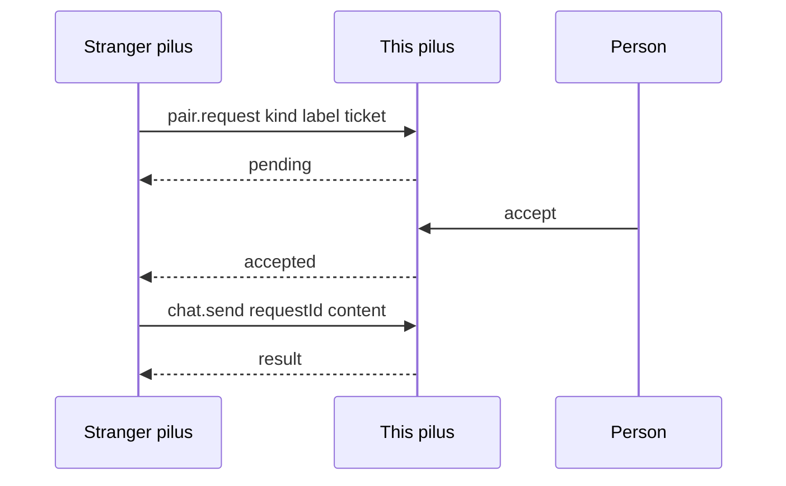

# Sipil network

## Summary

sipil is a second network beside the Luvus daemon. Every sipil — the durable agent daemon ([sipil](https://github.com/kepelet/sipil), a Node service over pi-durable) or another pilus window — is a node on one iroh protocol, ALPN `pilus/sipil/1`. A call is one bidirectional QUIC stream carrying one JSON object in and one out. There is no HTTP, no port, and no URL: a node is addressed by its **device ID**, the 64-hex `EndpointId` its identity key proves, and the caller's identity is whatever the handshake proved, never a field in the frame.

`pilus-protocol` is not involved. The daemon's `src/rpc.ts` and `wire.rs` are two ends of one contract, so they change together.

## Diagram

## Key components

- **Framing** — [wire.rs](../../crates/pilus-client/src/sipil/wire.rs): `{"method","params"?}` in, `{"result"}` or `{"error":{"code","message"}}` out. `API_VERSION` is 3 (1 was the removed HTTP API).
- **Node** — [node.rs](../../crates/pilus-client/src/sipil/node.rs) owns the process's iroh endpoint and a small tokio runtime behind blocking calls. The window runs calls on worker threads. The identity key is `~/.pilus/sipil/identity.key`; losing it changes the device ID everywhere it was added. `Node::ticket` also lists loopback so a same-machine node is reached directly.
- **People half** — [peer.rs](../../crates/pilus-client/src/sipil/peer.rs) bundles the node, contacts, channels, chat store, and `PeerService`. A pilus answers `health` for anyone and `chat.send`/`chan.send` only for contacts. A stranger's `chat.send` is refused unread and remembered as a request the person can accept.
- **Contacts** — [contacts.rs](../../crates/pilus-client/src/sipil/contacts.rs): being on the list is the whole of authorization. Adding is mutual by hand. A sipil daemon is a contact of a different kind and is never a person; it is admitted by `pair.request` and accepted by the person.
- **Channels** — [channels.rs](../../crates/pilus-client/src/sipil/channels.rs): named rooms with no server. The author fans `chan.send` out to every member that is a contact, in parallel. Each member keeps its own copy under `#<id>`. A member learns a channel from the first message naming it. The owner is the device that made it; only the owner's member lists and changes count. `added` and `removed` device IDs ride the line; a removal is kept per channel so an older list cannot restore the person.
- **Mentions** — [mention.rs](../../crates/pilus-client/src/sipil/mention.rs): `@Researcher` matched case-insensitively against connected daemons' agent names. In a channel it sends the line and hands the unseen lines to that agent in one session per conversation; the answer is said back under the agent's name (`as`) to everyone. An agent answers only in a channel its person invited it into. A direct chat is never handed to an agent, from either side.
- **Offline memory** — [offline.rs](../../crates/pilus-client/src/sipil/offline.rs) keeps each daemon's primary agent, the newest 200 lines of the 8 conversations last looked at, and an outbox. A message written while the daemon is away is queued under its request id and delivered in order after the next connect, so a cut-off delivery is not said twice.
- **Backoff** — [backoff.rs](../../crates/pilus-client/src/sipil/backoff.rs): no fixed dial beat. `Policy::DAEMON` is 3 s doubling, eight failures (~6 min); `Policy::PERSON` is 30 s doubling, six failures. After that it gives up until `wake`: the peer called us, the person opened or wrote to the conversation, or the app came to the front after resting.
- **Watch and history** — [watch.rs](../../crates/pilus-client/src/sipil/watch.rs) reduces the daemon's long-lived `watch` stream (snapshot, item, delta, live, status, output). [history.rs](../../crates/pilus-client/src/sipil/history.rs) keeps older pages when a newer one arrives so scrolling up leaves no gap.

## Authorization model

`health` is open and says what kind of node answered and whether the asker is allowed. Everything else needs an allow-list entry: a daemon's list is filled by `npm run connect` or `npm run allow`; a pilus's is its contact list. Treat a daemon's allow-list like SSH keys: an allowed device can run its agents' shell tools.

## Design decisions

- **Identity, not accounts.** No passwords and no server-held session: knowing a device ID grants nothing until the other side adds it.
- **Each member keeps its own copy.** There is no store-and-forward; a message some members missed says who, and absence is normal rather than an error.
- **Owner authority.** Member lists are believed only from the owner, so a removed member can neither read nor speak and learns it when every member refuses its next line.
- **Cheap absence.** Dialing a switched-off device is the most expensive idle action, so the network waits for news instead of polling.
- **The window owns the node.** Nothing is delivered while the window is closed; moving the node into `pilus-agent` would be the way to receive in the background.

## Related

- [Sipil device ID](../concepts/sipil-device-id.md)
- [pilus-client](../modules/client.md), [Native chrome and GPUI](./native-chrome.md)
- [Sipil message](../flows/sipil-message.md)
- [Idle cost](../concepts/idle-cost.md)
