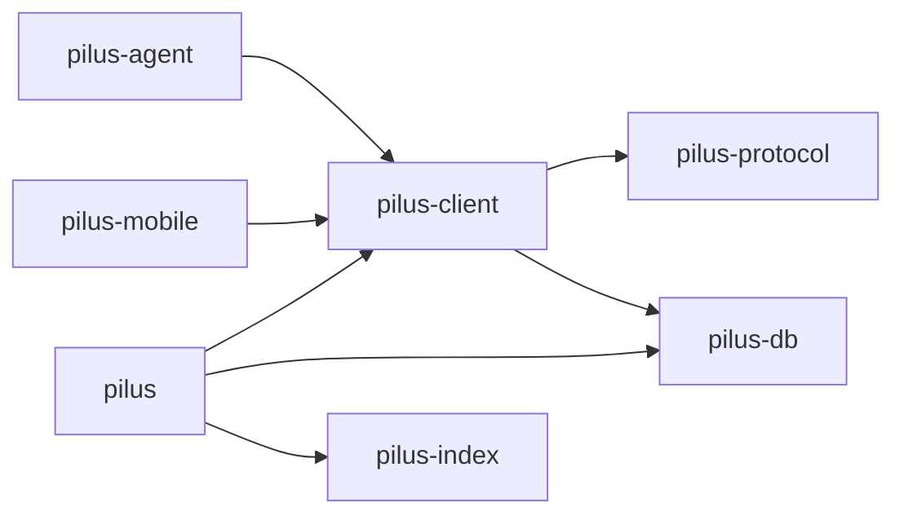
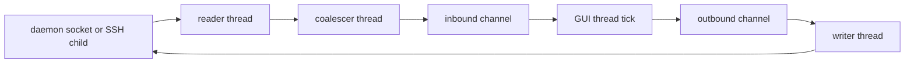

# System architecture

## Summary

`pilus` is a Cargo workspace (Rust 2024, `unsafe_code` and `unwrap_used` denied at workspace level) with a deliberately one-way dependency chain and two side doors. The desktop window is a thin painter over one daemon connection; the connection layer is shared by a host connector and a phone client from the other sides.

The workspace manifest lists all seven members in [Cargo.toml](../../Cargo.toml). `pilus-protocol` is the only crate that knows the binary wire format; `pilus-client` knows sockets, SSH, the handshake, UHP, and iroh; `pilus` is the only crate that knows GPUI.

## Key components

| Crate | Entry point | Role |
| --- | --- | --- |
| [pilus-protocol](../../crates/pilus-protocol/src/lib.rs) | `lib.rs` | `ClientMessage`/`ServerMessage`, `FrameData`/`FrameDiff`, positional bincode framing, theme/sound/window types |
| [pilus-client](../../crates/pilus-client/src/lib.rs) | `lib.rs` | Socket discovery, local and SSH transports, handshake, event stream, `Surface`, UHP control client, sipil client |
| [pilus](../../crates/pilus/src/main.rs) | `main.rs`, `cli.rs` | GPUI window, every native page, settings, logging, OTA updater, launch probes |
| [pilus-agent](../../crates/pilus-agent/src/main.rs) | `main.rs` | Host connector: gateway lifecycle, TCP and iroh transports, enrollment, hub, background service |
| [pilus-mobile](../../crates/pilus-mobile/src/lib.rs) | `lib.rs`, `ffi.rs` | Device-side iroh client, enrollment persistence, C ABI for Swift |
| [pilus-db](../../crates/pilus-db/src/lib.rs) | `lib.rs` | One shared SQLite connection per folder, append-only migrations, private-file helpers |
| [pilus-index](../../crates/pilus-index/src/lib.rs) | `lib.rs` | Transcript scan/parse, session index, token usage and pricing |

Each crate carries a `//!` header that states its role in the data flow; those headers are the most reliable map of intent and this wiki follows them.

## Entry points and launch modes

The window's CLI ([cli.rs](../../crates/pilus/src/cli.rs)) selects between the GUI and headless probes: `--probe`, `--probe-workspaces`, `--probe-machine <id>`, `--probe-uhp`, `--probe-feed`, `--check-updates`, and `--ui-shots`. `main.rs` initialises logging and the app icon, then dispatches. The `visual-test` feature is not part of a normal build; its captures are the release gate for UI work.

The connector ([main.rs](../../crates/pilus-agent/src/main.rs)) has `serve` (TCP or `--iroh`), `descriptor`, and `service install|uninstall|restart|status`. The mobile crate builds as a static library (`libpilus_mobile`) for the iOS target.

## Threading model

The GUI thread never blocks on IO. Every source of latency has an owner thread:

`Connection::open` performs the handshake synchronously, then spawns a writer, a reader, and a coalescer ([connection.rs](../../crates/pilus-client/src/connection.rs)). The reader decodes frames off the GUI thread; the coalescer collapses bursts so a fast daemon cannot starve painting. The window drains `ClientEvent`s on its tick (16 ms while animating, 50 ms idle in front, 250 ms behind another app) and repaints only when the `Surface` changed.

Other background work follows the same rule: UHP snapshots and commands ([control.rs](../../crates/pilus-client/src/control.rs)), sipil connects and calls ([gui/sipil.rs](../../crates/pilus/src/gui/sipil.rs)), GitHub cache reads (`GhAccount`), the indexer ([refresh.rs](../../crates/pilus-index/src/refresh.rs)), and every `gh`/`git`/`ssh` subprocess. Results return through channels or a swapped `Arc` snapshot.

## Design decisions

- **Paint, don't re-derive.** The daemon owns layout; the client owns pixels. This keeps the native client small and guarantees feature parity for TUI features it has never heard of.
- **Two surfaces, not one.** The render socket is a binary frame stream; structured state (agents, tabs, bar widgets, diffs, files, git) goes through UHP on the control socket. See [UHP](../concepts/uhp.md).
- **One-way dependencies.** The protocol crate cannot depend on GPUI, and the connector cannot enter the window's graph, so the connection layer stays headlessly testable (`crates/pilus-client/tests/handshake.rs`).
- **Durable vs rebuildable state.** `pilus.db` is migrated forever; `index.db` is a cache whose schema bump drops it. See [Persistence](./persistence.md) and [Migrations](../concepts/migrations.md).
- **Build with the command-line tools.** `runtime_shaders` on the pinned `gpui-pre` and `syntect`'s pure-Rust regex backend keep the macOS build from invoking the Metal compiler or compiling onig. See the comments in [Cargo.toml](../../Cargo.toml).
- **The GUI is a client, not a daemon.** The window creates its sipil identity key on open and owns the node; the connector owns remote access. Both are separate from `pilus-agent`'s supervisor so closing the window does not break a phone session.

## Related

- [Daemon surface and wire protocol](./daemon-surface.md)
- [Native chrome and GPUI](./native-chrome.md)
- [Remote access and the hub](./remote-access.md)
- [pilus-client](../modules/client.md), [pilus-protocol](../modules/protocol.md)
- [Attach and paint](../flows/attach-and-paint.md)
