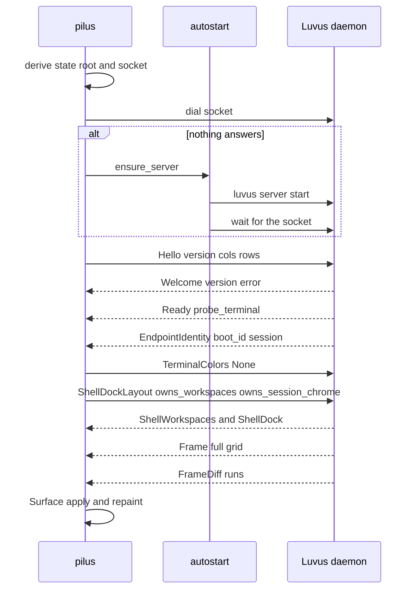

# Attach and paint

## Summary

The first thing the window does is attach: resolve a daemon socket, start the daemon if it is not running, perform the version-checked handshake, claim the sidebar, and begin folding frames. This flow is the spine every other feature hangs from.

## Trigger

Launch with no `--socket`/`--session` override, or a reconnect after a dropped link.

## Sequence diagram

## Steps

1. **Resolve the socket.** [discovery.rs](../../crates/pilus-client/src/discovery.rs) picks `$LUVUS_HOME` (else `~/.luvus`, `~/.luvus-dev` in debug), then the default or named session socket. A path too long for `sun_path` moves to a hashed alias under the temp directory.
2. **Open a transport.** [transport.rs](../../crates/pilus-client/src/transport.rs) connects a Unix socket, a TCP address, or an `ssh -T` child. `SshTarget` builds the SSH command and notes it in `netlog`.
3. **Start the daemon if needed.** [autostart.rs](../../crates/pilus-client/src/autostart.rs) runs `luvus [--session NAME] server start` with `LUVUS_HOME` pinned, then dials until the socket answers. File existence is not liveness.
4. **Handshake.** [connection.rs](../../crates/pilus-client/src/connection.rs) sends `Hello`, decodes `Welcome` before checking the version, accepts `Ready` and `EndpointIdentity`, and answers the terminal-color probe because the daemon will not stream otherwise.
5. **Spawn threads.** A writer drains the outbound channel; a reader decodes messages on a dedicated thread (setting `DECODE_VERSION` first); a coalescer collapses bursts.
6. **Claim chrome.** The window sends `ShellDockLayout` with `owns_workspaces` and `owns_session_chrome`, drops the agents dock from `ShellSidebars`, and starts drawing the sidebar from `ShellWorkspaces` and `ShellDock`.
7. **Paint.** `Surface::apply` folds frames and diffs. A full frame replaces the grid; a `FrameDiff` is validated by `FrameData::apply_diff`, and a rejected diff leaves the old grid and flags `needs_full_frame`.
8. **React to out-of-band messages.** `take_notify`, `take_sounds`, `take_clipboard`, `take_open_url`, and workspace changes are drained each tick. `Arrival` wakes the tick immediately when a frame lands.
9. **Forward input.** Keys map through [keys.rs](../../crates/pilus/src/gui/keys.rs); clicks send `Down`/`Up`; drags stay client-side as selection; resize sends `Resize`.

## Failure modes

- **No daemon and no `luvus` binary** — attach fails with the OS error; the window shows the connection state instead of a blank grid.
- **Version mismatch** — the handshake retries at `FALLBACK_PROTOCOL_VERSION` (18); a daemon that rejects both produces the `Welcome` error text.
- **Malformed diff** — rejected whole, `needs_full_frame` set, one resync request sent per outage (`resync_requested`).
- **SSH child dies** — the last `Connection` clone kills it; the reader unblocks and the endpoint reconnects with backoff.
- **Socket path too long** — the aliased path is used by both sides; a mismatch would present as “nothing answers” and trigger autostart.

## Related

- [Daemon surface and wire protocol](../architecture/daemon-surface.md)
- [Surface](../concepts/surface.md), [UHP](../concepts/uhp.md)
- [pilus-client](../modules/client.md), [pilus-protocol](../modules/protocol.md)
- [Switch machines](./machine-switch.md)
