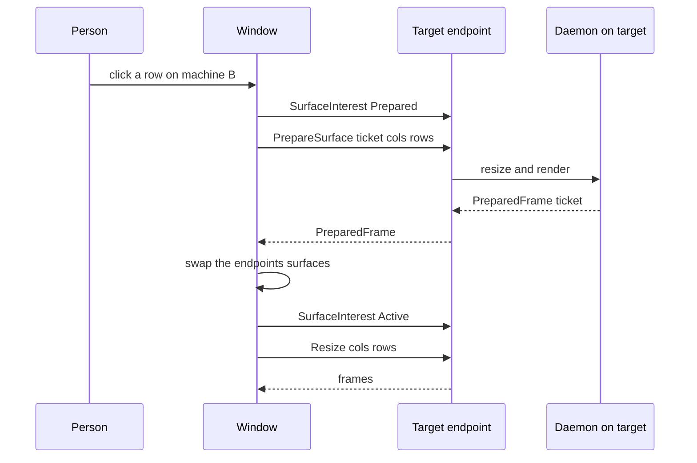

# Switch machines

## Summary

One window can hold Local plus every enabled SSH machine as endpoints. Each endpoint has its own connection, surface, tabs, agents, and status bar; only one is visible. Switching is a two-phase handoff: prepare the target, receive a prepared frame, then swap surfaces, so the screen never blanks on a slow SSH round trip.

## Trigger

Selecting a workspace or agent row that belongs to another endpoint, or choosing a machine in the Open Workspace picker.

## Sequence diagram

## Steps

1. **Catalog.** Saved profiles are read through `luvus machine list --json` ([machines.rs](../../crates/pilus-client/src/machines.rs)). Each enabled profile becomes an endpoint; the owner-local daemon is one too.
2. **Bridge.** Every enabled machine is connected at startup in parallel: `ssh -T -o BatchMode=yes … <binary> [--session NAME] remote-client-bridge` ([transport.rs](../../crates/pilus-client/src/transport.rs), `machines::connect_machine`).
3. **Stay quiet while hidden.** Inactive endpoints are sent `SurfaceInterest::Suspended`. They still project `ShellWorkspaces`, so their rows render, but stream no frames and own no input or PTY size.
4. **Prepare.** Selecting an endpoint sends `Prepared` and a ticket-tagged `PrepareSurface`. The target resizes and renders off-screen.
5. **Commit.** The matching `PreparedFrame` is committed by swapping the endpoints' surfaces; then `Active` and a `Resize` go to the new endpoint. The clicked row highlights optimistically until commit or until every stage ends without a frame.
6. **Keep sizes honest.** Window resizes are pushed to every bridge, not only the active one, so a hidden machine's panes are already at the window size and switching does not visibly reflow.
7. **Refresh chrome.** The hidden-endpoint feed (`agent.list`, `tab.list`, `ui.bar.list`) keeps each endpoint's tabs and agents current, so a switch has data immediately.

## Failure modes

- **Stalled handoff** — commits after a bounded timeout only if the target holds a frame; a timed-out destination never blanks a usable surface. Re-selecting the visible endpoint cancels the switch.
- **SSH failure** — the bridge retries with capped exponential backoff and jitter (1 s doubling to 30 s), one attempt per endpoint. A host that answers its probe again resets the budget.
- **Machine catalog changes** — `MachineCatalogChanged` and a shared revision make every open window reload the catalog at once.
- **Remote control is slower** — `uhp proxy` forwards one request, so a remote feed reconciles on a short timer instead of holding an event stream; an active feed also runs an agents-only lane.

## Related

- [Endpoint](../concepts/endpoint.md)
- [Remote access and the hub](../architecture/remote-access.md)
- [pilus-client](../modules/client.md), [pilus (GUI)](../modules/gui.md)
- [Attach and paint](./attach-and-paint.md)
