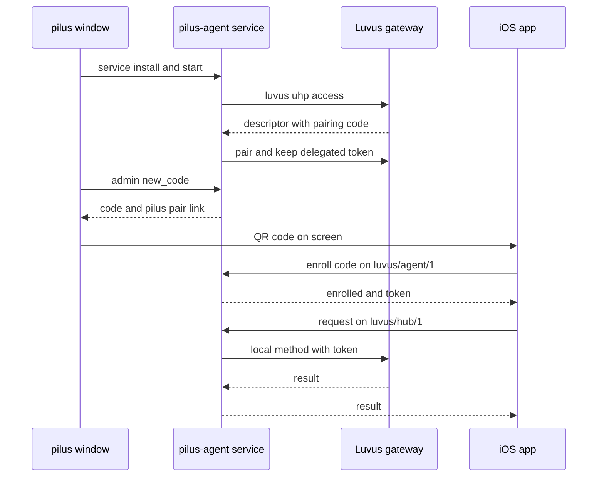

# Pair a phone

## Summary

Remote access turns the Mac into a reachable host for the iOS app. The window installs a background service; the service launches a Luvus access gateway, pairs with it, and holds its delegated token. A phone scans a QR code, enrolls once over `luvus/agent/1`, and from then on is authorized by its iroh `EndpointId`. Requests go to the hub on `luvus/hub/1`, which forwards them to this machine's gateway or to a saved SSH machine.

## Trigger

Settings → Remote access switched on, then **Add device**.

## Sequence diagram

## Steps

1. **Install the service.** [service.rs](../../crates/pilus-agent/src/service.rs) writes a LaunchAgent or user systemd unit. `install` is idempotent and leaves a healthy running service alone.
2. **Start the gateway.** [supervisor.rs](../../crates/pilus-agent/src/supervisor.rs) launches `luvus uhp access`, parses the one-line descriptor, and publishes the token to `AuthState`. When the child exits, it restarts with capped backoff.
3. **Mint a code.** The window asks the admin socket for `new_code` ([admin.rs](../../crates/pilus-agent/src/admin.rs)); the answer is a short code plus a `pilus://pair/<ticket>?code=…` link, shown as a QR. The code is one-use, lasts ten minutes, and is rotated after each enrollment.
4. **Enroll.** The app connects on `luvus/agent/1` and sends `{"type":"enroll","code":…}` ([enroll.rs](../../crates/pilus-agent/src/enroll.rs)). The connector admits the peer, persists its `EndpointId` and level in `devices.json`, and returns the cached token. Later `{"type":"token"}` calls refresh it without re-enrolling.
5. **Send a request.** The app opens `luvus/hub/1` and sends `{"id","machine","method","params"}`. `local` goes to the gateway with the token; any other id goes through `luvus uhp proxy` over SSH.
6. **Check authority.** The hub looks up the device's level per stream, checks the method against `view`/`control`/`operate` allow-lists, and refuses streaming or blocking methods. A lowered or revoked device is refused on its next request, even on an open connection.
7. **Follow changes.** `hub.watch` subscribes to the daemon's event feed and sends topic signals; the app refetches the lists the signal names under its own level.

## Failure modes

- **Luvus not running** — the supervisor may run `server start` at most once a minute; Settings shows *Waiting for Luvus* with a **Start Luvus** button (`retry` cuts the backoff short).
- **Gateway restart** — devices fetch the token on demand, so none needs to re-enroll; while the gateway is down a stream gets a UHP-shaped `unavailable` error instead of hanging.
- **Lost reply** — the phone reports `unconfirmed`; it resends only reads and idempotency-keyed calls (`hub.run`, `automation.create`, `automation.run`).
- **Revoked or lowered device** — refused on the next request of an open stream; the watch stream is cut on its next ping.
- **No enrollment code** — the code is in memory only. The service mints a fresh one over the admin socket; a restart is never needed.
- **Binary replaced by an update** — `status` reports `restart_needed`; the window runs `service restart` at launch and devices redial.

## Related

- [Remote access and the hub](../architecture/remote-access.md)
- [Enrollment level](../concepts/enrollment-level.md)
- [pilus-agent](../modules/agent.md), [pilus-mobile](../modules/mobile.md), [iOS app](../modules/ios-app.md)
