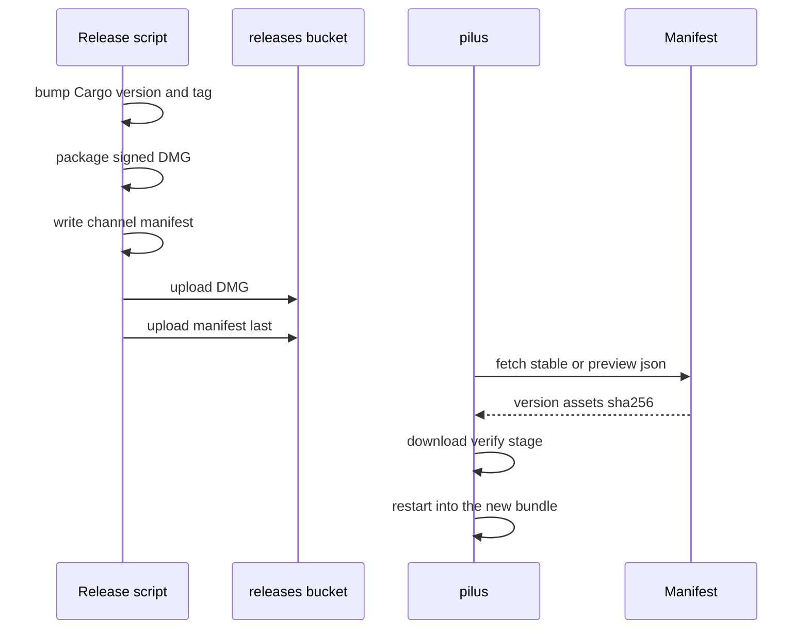

# Release and update

## Summary

pilus ships as a signed macOS DMG and updates itself from channel manifests hosted on Cloudflare R2. The same manifest shape serves stable, preview, and a local `127.0.0.1` feed, so the update path can be exercised without publishing.

## Trigger

A release: version bump and tag. An update: `pilus → Check for Updates…`, an automatic check, or `--check-updates`.

## Sequence diagram

## Steps

1. **Build and package.** [scripts/package-macos-dmg.sh](../../scripts/package-macos-dmg.sh) produces a signed, notarized DMG whose root holds one `pilus.app`, an `Applications` link, and the drag-to-install background. [scripts/bundle-macos.sh](../../scripts/bundle-macos.sh) assembles the bundle, including `pilus-agent` beside the main binary.
2. **Write the manifest.** [scripts/write-manifest.sh](../../scripts/write-manifest.sh) bakes the hosting URL into `name`/`url`/`sha256` for each asset. Asset names stay `pilus-v<version>-macos-<arch>.dmg`; the updater's source matches on `macos`, the arch, and `.dmg`.
3. **Publish.** [scripts/publish-release.sh](../../scripts/publish-release.sh) uploads the DMG and then the manifest, so a client never reads a manifest whose artifact is missing. Preview DMGs live under `preview/` because the filename carries only the Cargo version.
4. **Check.** [update.rs](../../crates/pilus/src/update.rs) resolves the channel and feed URL (CLI, then environment, then settings). Stable is `https://releases.kepelet.com/pilus/stable.json`; preview/nightly aliases point at `preview.json`. An explicit feed URL wins.
5. **Download and install.** [gui/updater.rs](../../crates/pilus/src/gui/updater.rs) runs the blocking `gpui-updater-core` pipeline on GPUI's background executor and reports progress through `UpdateStatus`; the GUI thread never blocks. The DMG is mounted, the bundle copied with `ditto` to preserve its signature, and a staged update sets the restart path.
6. **Restart.** `Restart` relaunches into the new bundle. A failed check or download opens the native Update window with Retry rather than a footer pill.
7. **Local preview.** `just preview-feed` + `just serve-preview` serve a payload at `http://127.0.0.1:8000/latest.json`; `just check-updates --feed-url …` exercises the client without a window.

## Failure modes

- **Channel and URL disagree** — an explicit `update_feed_url` always wins, so a self-hosted manifest needs no code change.
- **Manifest without artifact** — cannot happen by ordering, because the manifest is uploaded last; a manually published bad manifest opens the Update window with Retry.
- **Wrong asset name** — the source refuses to match it; keep `pilus-v<version>-macos-<arch>.dmg`.
- **Daemon updates are separate and pinned** — `luvus_update.rs` installs and updates only to the release in `crates/pilus/luvus.pin` (checked against its pinned SHA-256), installs it by itself on first run when no `luvus` exists, never downgrades, refuses a package-manager install, and restarts through `luvus server restart`; a machine row re-provisions with `luvus machine enable <id> --install`. Bump the pin with `just pin-luvus <version>`.
- **Service binary replaced** — the connector reports `restart_needed` and the window restarts the service at launch; devices redial.

## Related

- [Site, infra, and release scripts](../modules/site-and-infra.md)
- [pilus (GUI)](../modules/gui.md)
- [docs/ota.md](../../docs/ota.md), [docs/infra.md](../../docs/infra.md)
