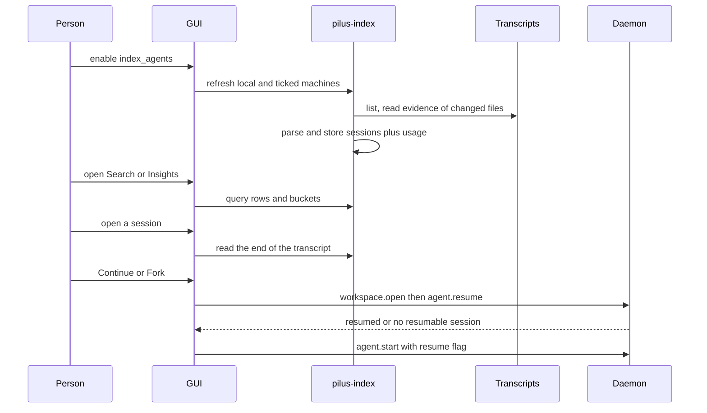

# Search, stats, and resume

## Summary

The same transcript index powers three surfaces: Search lists recent sessions, Insights totals their token use, and a session page replays a conversation and can continue or fork it. All three are gated by one consent decision.

## Trigger

The person turns on session indexing, then opens Search, Insights, or a session row.

## Sequence diagram

## Steps

1. **Consent.** `Settings::index_agents` must be on; a remote machine is read only while its id is in `Settings::index_machines`. Nothing in `pilus-index` checks this; the GUI does.
2. **Scan.** [scan.rs](../../crates/pilus-index/src/scan.rs) lists transcripts and reads evidence lines only from files whose size or mtime changed. The local reader and the remote evidence script choose the same lines.
3. **Parse.** [parse.rs](../../crates/pilus-index/src/parse.rs) turns evidence into a title and metadata; [usage.rs](../../crates/pilus-index/src/usage.rs) reads assistant turns and dedupes repeated streamed ids.
4. **Store.** [store.rs](../../crates/pilus-index/src/store.rs) writes the session and its usage buckets in one transaction, so a session never exists without the usage its size says was read.
5. **Read.** Search filters by machine and agent; Insights groups UTC hours into the viewer's offset and prices turns. Pi's recorded cost wins; otherwise [pricing.rs](../../crates/pilus-index/src/pricing.rs) estimates at list price when the page asks. Unpriced tokens are counted but excluded from dollars.
6. **Replay.** [session_view.rs](../../crates/pilus/src/gui/session_view.rs) reads the last `WINDOW` (4 MB) of the transcript and extends upward to `MAX_WINDOW` as the reader scrolls; older entries are inserted in front. The text is shown and kept nowhere.
7. **Resume.** Continue/Fork sends `workspace.open` on the session's folder and then `agent.resume` on its machine's daemon. On “no resumable session”, an agent with `Agent::resume_flag` (Claude) is launched by `agent.start` with `--resume <id>`; Fork uses the agent's own fork flag, never the daemon's resume.

## Failure modes

- **Consent off** — Search and Insights show the consent card; no transcript is read. Turning it off calls `pilus_index::wipe`.
- **A machine cannot be listed** — it keeps its rows; the local pass still runs.
- **Stale cache** — `store::SCHEMA` changes drop and rebuild the file; there are no migrations.
- **Transcript too large** — the session page reads a bounded window; a truncated read is never opened for editing.
- **Remote read fails** — the page reports it; nothing is cached from a partial read.
- **No resumable session** — the fallback launch path is used, not an error.

## Related

- [pilus-index](../modules/index.md)
- [Persistence and data ownership](../architecture/persistence.md)
- [Migrations](../concepts/migrations.md)
- [pilus (GUI)](../modules/gui.md)
