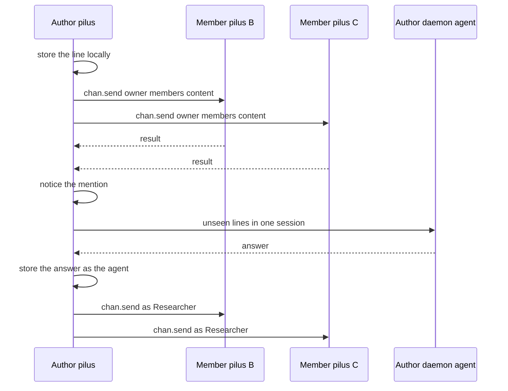

# Sipil message

## Summary

A line in a sipil channel is sent to every member, stored locally by each receiver, and — if it names an invited agent — handed to that agent, whose answer is said back under its name. There is no server and no store-and-forward: delivery is the author's fan-out, and absence is normal.

## Trigger

Sending from a channel's chat page, or a contact's pilus accepting an inbound `chan.send`.

## Sequence diagram

## Steps

1. **Compose and store.** The chat page appends the line to the local chat store (`chat_lines`) and sends it as `chan.send { channel, name, members, requestId, content, reply?, as? }` ([channels.rs](../../crates/pilus-client/src/sipil/channels.rs)).
2. **Fan out.** The author's pilus sends one call per member that is a contact, in parallel, so one absent member holds nobody up. A member that is not a contact is not written to or listened to.
3. **Receive.** A receiver checks that the channel is known and that it has not left it (`Learned::Left`), then stores the line under `#<id>` together with the `requestId` so a retry is one message. A pilus that does not know the channel learns it from the name and members the message carries, but accepts lists and changes only from the owner.
4. **Detect a mention.** [mention.rs](../../crates/pilus-client/src/sipil/mention.rs) matches `@Name` case-insensitively against the connected daemons' agent names. Only the author's own agents answer, and only when the person invited them into the channel (`Channels::set_agent`, kept on that device only).
5. **Hand over.** For a member's line, `PeerService::invite_agents` turns the mention into `Event::Mentioned`, answered on the spot by [gui/sipil_social.rs](../../crates/pilus/src/gui/sipil_social.rs); for the person's own line, `bring_in_agents` does the same. The daemon gets the lines it has not seen, with who said each, in one session per conversation. The cursor lives in the chat store.
6. **Answer.** The daemon's reply is sent back as `chan.send` with `as: "Researcher"`, to everyone. A line an agent said never starts another agent.
7. **Direct chats are exempt.** `bring_in_agents`, `answer_invited`, and `answer_mention` all refuse a `Conversation::Direct`; no agent reads or speaks in a chat between two people.

## Failure modes

- **A member is offline or refuses** — the message is not delivered to them; the sending pilus says who missed it. There is no queue at the channel level.
- **Unknown or left channel** — the receiver drops the message (`Learned::Left`); a member that was away finds out when every member refuses its next line.
- **Not a member** — a message from someone not in a known channel's list is refused with `not_member`, and the sender is told and forgets the channel.
- **Owner change** — only the owner's `added`/`removed` lists count. A removal is persisted per channel, so an older list cannot bring the person back; only an `added` can.
- **Agent not invited** — naming it does nothing, for the person and every member alike.
- **Daemon away** — its agent is not reachable; the offline snapshot still lets the person open the conversation, and a queued message is delivered after the next connect.

## Related

- [Sipil network](../architecture/sipil-network.md)
- [Sipil device ID](../concepts/sipil-device-id.md), [Idle cost](../concepts/idle-cost.md)
- [pilus-client](../modules/client.md), [pilus (GUI)](../modules/gui.md)
